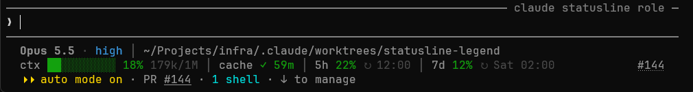

# BruzIT Infra

[](LICENSE)
[](https://github.com/bruzit/infra/commits)
[](https://github.com/bruzit/infra/actions/workflows/megalinter.yaml)
[](https://github.com/bruzit/infra/actions/workflows/terraform-test.yaml)
[](https://github.com/bruzit/infra/actions/workflows/semantic-release.yaml)
[](https://github.com/bruzit/infra/actions/workflows/terraform.yaml)

Infrastructure blueprints for workstations, home network, edge Kubernetes lab, and self-hosted services, provisioned with Ansible and Terraform under GitOps.

## Features

| Blueprint       | Scope                                              | Status      | Provisioned                                               |
|-----------------|----------------------------------------------------|-------------|-----------------------------------------------------------|
| `PC`            | Workstations, laptops, gaming desktop, peripherals | In progress | `workstations`, `wsl`; peripherals not yet                |
| `home-net`      | Routers, APs, switches, UPS, cabling               | Planned     | None                                                      |
| `home-lab`      | Bare-metal servers, storage, Kubernetes            | Planned     | None; `appliances` inventory only                         |
| `home-services` | Self-hosted services and their backups             | In progress | `media` (Kodi); backups not yet                           |
| `home-web`      | Edge static hosting, CDN, domains                  | In progress | `cloud` test server (Terraform, Hetzner); hosting not yet |

Status: Provisioned (whole scope converged by `playbook.yaml` or Terraform), In progress (part of the scope), Planned (not started).

## Requirements

- Ubuntu 24.04 or newer; `appliances` (Synology DSM) are inventory only.
- ansible-core 2.20 or newer (required by [BruzIT Ansible Collection](https://github.com/bruzit/ansible-collection)), collections in [`requirements.yaml`](requirements.yaml).
- Cloud: Terraform 1.15 or newer 1.x, direnv, a Hetzner Cloud project and a Cloudflare R2 bucket for state.

## Installation and Setup

### Hosts

| Group          | Hosts                                        | Connection          |
|----------------|----------------------------------------------|---------------------|
| `workstations` | `pc0` (lab), `pc2` (backup), `pc4` (primary) | SSH                 |
| `media`        | `pc3` (lab), `pc1`                           | SSH                 |
| `wsl`          | `wsl-beta` (backup)                          | Local               |
| `cloud`        | `cloud0` (Hetzner, `hcloud.yaml`)            | SSH                 |
| `appliances`   | `nas0`, `nas1`                               | None (Synology DSM) |

Tier groups set `bruzit_tier`: `test` (`pc0`, `pc3`, `cloud0`), `prod` (the rest); the playbook fails hosts without a valid tier.

### Bootstrap

On a fresh system, install git and Ansible, then clone over HTTPS into `~/Projects`; the `git` role skips existing clones. apt ships ansible-core 2.20 from Ubuntu 26.04; on 24.04, use `pipx install ansible`.

```bash
sudo apt install -y git ansible-core
git clone https://github.com/bruzit/infra.git ~/Projects/infra
cd ~/Projects/infra
ansible-galaxy collection install -r requirements.yaml
```

Add the host to [`inventory.yaml`](inventory.yaml) under `workstations`, `media` or `wsl`, then run the playbook locally; it authorizes the keys from `github.com/bruzina.keys` and installs the SSH server:

```bash
ansible-playbook -K -c local -l <host> playbook.yaml
```

After that, run it from any controller. It reaches SSH hosts by hostname; on Ubuntu 25.10 and newer it becomes root via `sudo.ws` automatically.

### Controller

Every `workstations` and `wsl` host is a controller, a machine that runs Ansible: `pc4` is the primary one, `pc2` and `wsl-beta` are backups. The first local run installs gh (git credential helper) and direnv, and generates the SSH key `~/.ssh/id_ed25519` and the commit signing key `~/.ssh/id_ed25519_signing`. Log in to GitHub and register both keys; if you're already logged in, run `gh auth refresh -s admin:ssh_signing_key` first:

```bash
gh auth login -h github.com -p https -w -s admin:public_key,admin:ssh_signing_key
gh ssh-key add ~/.ssh/id_ed25519.pub -t <host>
gh ssh-key add ~/.ssh/id_ed25519_signing.pub --type signing -t <host>
```

Copy the `.env*` files and GitHub App PEMs from an existing controller into the matching checkouts under `~/Projects`, then run `direnv allow` in each. From an existing controller, re-run the playbook on the other SSH hosts so they authorize the new key, then verify:

```bash
ansible-playbook -K -l <host> playbook.yaml
ansible -m ping workstations:media
```

## Usage

### Provision Hosts

Define accounts once in [`group_vars/all/accounts.yaml`](group_vars/all/accounts.yaml); the playbook clones each account's `repositories` into `~/Projects`. Roles per group, from [`playbook.yaml`](playbook.yaml):

| Group                            | Roles                                                                                                                                  |
|----------------------------------|----------------------------------------------------------------------------------------------------------------------------------------|
| All but `appliances`             | apt, users                                                                                                                             |
| `workstations`, `wsl`            | SSH key, git (identity, SSH commit signing, clones), claude, direnv, starship, gh, bitwarden_cli, terraform, docker, jq, pwgen, yq, mc |
| `workstations`, `media`, `cloud` | ssh_server, fail2ban                                                                                                                   |
| `workstations`, `media`          | grub (10 s menu), tmp (tmpfs `/tmp`), nfs_client: `nas0` `mm` read-only; on `workstations` also `nas1` `mb`, `bruzit` read-write       |
| `workstations`                   | snap, obsidian, widelands, nerd_font, vscode, vscodium, google_chrome, openttd; unattended_upgrades without reboot                     |
| `media`, `cloud`                 | unattended_upgrades with automatic reboot                                                                                              |
| `media`                          | kodi_youtube, kodi_netflix: Kodi with YouTube, Netflix and InputStream Adaptive add-ons, web remote control, Avahi discovery           |
| `wsl`                            | wsl: systemd, snapd purged, Windows browser for `gh` and `xdg-open`; no nftables firewall                                              |

Always limit the run with `-l`. `-K` prompts for the sudo password; without a TTY, use a password file:

```bash
ansible-playbook -K -l <host> playbook.yaml
ANSIBLE_BECOME_PASSWORD_FILE=~/.ansible_become ansible-playbook -l <host> playbook.yaml
```

Host notes:

- `workstations`, `media`: NAS shares mount under `/mnt/<nas>/<share>` on first access. Set up the NFS exports by hand in DSM, restricted to these hosts.
- `media`: set the Kodi web server password as `KODI_WEBSERVER_PASSWORD` in `.env`. `pc1` outputs to its `HDMI-A-1` TV with HDMI audio.
- `wsl`: after the first run, run `wsl --shutdown` from Windows. `ansible.builtin.reboot` refuses local connections, so keep `system_reboot_when_needed` false and reboot by hand after kernel upgrades. `wsl-beta` resolves DNS via the WSL NAT gateway. I deliberately skip the default-deny inbound nftables firewall here: WSL NAT exposes the host only to Windows, whose firewall applies, so the `nftables` role is off on WSL by default.

### Claude Code Status Line

The playbook installs [`claude/statusline`](claude/statusline) as `~/.claude/statusline` (`claude_statusline_src` in [`group_vars/all/claude.yaml`](group_vars/all/claude.yaml)). It needs `jq`; `git` and `timeout` are optional. It prints two rows above Claude Code's mode row. Percentages are green below 50 %, yellow from 50 %, red from 80 %; `–` means no data.



| Row 1          | Meaning                                                                      |
|----------------|------------------------------------------------------------------------------|
| **Opus 5.5**   | Model                                                                        |
| &#x26A1;       | Fast mode on                                                                 |
| ∅ think        | Thinking off                                                                 |
| · medium       | Effort level                                                                 |
| `~/Projects/x` | Working directory, original one in a worktree; `…` = truncated from the left |
| +N             | Added directories                                                            |

| Row 2                      | Meaning                                                                            |
|----------------------------|------------------------------------------------------------------------------------|
| ctx ██░░░░░░░░ 21% 208k/1M | Context window used, input tokens / window size                                    |
| ⚑                          | Over 200k tokens                                                                   |
| ⚠ /compact                 | Context ≥ 80 % used                                                                |
| cache ✓ 59m                | Prompt cache warm, minutes left; yellow ≤ 10 min (≤ 2 min for 5m TTL), red < 1 min |
| cache ✗ 150k               | Prompt cache cold, tokens to re-cache                                              |
| 42% ⚠ cause                | Cache hit ratio < 80 % with misses, top miss cause                                 |
| 5h 4% ↻ 13:10              | 5-hour rate limit used, reset time                                                 |
| 7d 14% ↻ Tue 21:00         | 7-day rate limit used, reset time                                                  |
| ▲                          | Rate limit used ahead of even pace by more than 5 points                           |
| $ 30% ↻ …                  | Spend limit used, reset time                                                       |

| Row 2, right   | Meaning                                                                                                     |
|----------------|-------------------------------------------------------------------------------------------------------------|
| `main` ✱ ↑1 ↓2 | Git branch (short commit when detached), uncommitted changes, commits ahead, behind                         |
| ⎇ name         | Worktree                                                                                                    |
| #12 ✓ approved | Pull request (`!12` = GitLab merge request), clickable; ✓ approved, ● pending, ✗ changes requested, ◌ draft |

On a narrow terminal, it drops token counts first, then the 7-day reset time, cache miss cause and spend reset time; the right segment drops the pull request label, then moves to a third row.

### Cloud

[`terraform/hetzner/`](terraform/hetzner) creates the `test` environment in the Hetzner Cloud project "BruzIT Test": server `cloud0` (`cx23`, `hel1`, Ubuntu 26.04), a firewall allowing only SSH (22/tcp, key-only) and ICMP inbound, and an SSH key per key on `github.com/bruzina.keys`.
cloud-init creates user `mb` with those keys and passwordless sudo, and disables root and password login. State lives in the R2 bucket `$AWS_BUCKET`, one Terraform workspace per environment. Addresses are private: outputs are sensitive and the workflow masks IP addresses.

Credentials come from direnv: `.env` (shared, from `.env.tmpl`) and `.env.<env>.<mode>` (from `.env.test.<mode>.tmpl`), selected by `TF_ENV` (default `test`) and `TF_MODE` (`plan`, the default, with read-only tokens, or `apply` with read-write tokens).

Bootstrap the workspace once; the read-only R2 token can't create it:

```bash
TF_MODE=apply direnv exec . terraform -chdir=terraform/hetzner init -backend-config="bucket=$AWS_BUCKET"
```

Plan, apply and destroy locally:

```bash
terraform -chdir=terraform/hetzner init -backend-config="bucket=$AWS_BUCKET"
terraform -chdir=terraform/hetzner plan -lock=false
TF_MODE=apply direnv exec . terraform -chdir=terraform/hetzner apply
TF_MODE=apply direnv exec . terraform -chdir=terraform/hetzner destroy
```

SSH in: `ssh mb@"$(terraform -chdir=terraform/hetzner output -raw ipv4_address)"`.

The hcloud inventory plugin discovers the servers ([hetzner.hcloud: hcloud inventory plugin documentation](https://docs.ansible.com/ansible/latest/collections/hetzner/hcloud/hcloud_inventory.html)) via [`hcloud.yaml`](hcloud.yaml) with `HCLOUD_TOKEN`. Servers labeled `role=cloud` form the inventory group `cloud`; their `env` label (the Terraform workspace, i.e. the tier) sets the tier group and `bruzit_tier`. Ansible reaches them by public IPv4 as `mb` (passwordless sudo, no `-K`). `hcloud.yaml` isn't in `ansible.cfg` because it fails without a token, so pass both inventories. `TF_ENV` picks the token and so the Hetzner project; `-l 'cloud:&<env>'` guards against a mismatched `TF_ENV`, which then selects no hosts. Converge the test environment: run the `Terraform` workflow with `apply` and approve it, then:

```bash
TF_ENV=test direnv exec . ansible-playbook -i inventory.yaml -i hcloud.yaml -l 'cloud:&test' playbook.yaml
```

Then run the workflow with `destroy`. Unknown host keys are accepted on first contact; if a recycled address comes with a changed key, run `ssh-keygen -R <address>`.

## Support

[Open a GitHub issue](../../issues). This repository is a demo, a reference implementation of BruzIT products in use, so I answer best effort.

## Testing

Pull requests run MegaLinter (Ansible, Terraform, YAML, Markdown, GitHub Actions) and Terraform `fmt`, `validate` and `test` with mocked providers. Run the Terraform tests locally:

```bash
terraform -chdir=terraform/hetzner init -backend=false && terraform -chdir=terraform/hetzner test
```

## Integration and Deployment

| Workflow                                                            | Trigger                          | Purpose                                                                                   |
|---------------------------------------------------------------------|----------------------------------|-------------------------------------------------------------------------------------------|
| [MegaLinter](.github/workflows/megalinter.yaml)                     | Pull request                     | Lint changed files; required check `Required (MegaLinter)`                                |
| [Terraform Test](.github/workflows/terraform-test.yaml)             | Pull request                     | Terraform `fmt`, `validate`, `test`; required check `Required (Terraform Test)`           |
| [MegaLinter Scheduled](.github/workflows/megalinter-scheduled.yaml) | Weekly, Monday 06:00 UTC; manual | Lint the whole codebase                                                                   |
| [Semantic Release](.github/workflows/semantic-release.yaml)         | Push to `main`                   | Version, changelog and GitHub release                                                     |
| [Terraform](.github/workflows/terraform.yaml)                       | Manual, `apply` or `destroy`     | `Plan` read-only in environment `test-plan`; `Apply` after approval of environment `test` |

The `Terraform` workflow writes the IP-masked plan to the job summary; `Apply` plans again before applying or destroying. Destroy promptly after testing; the server is billed hourly.

## Contributing

Open a pull request to `main`. Write commits per the [Conventional Commits 1.0.0 specification](https://www.conventionalcommits.org/en/v1.0.0/); semantic-release sets the version and changelog from them.

## License and Copyright

MIT License: [`LICENSE`](LICENSE)  
Copyright © 2026 Martin Bružina

## References

- [BruzIT Ansible Collection](https://github.com/bruzit/ansible-collection)
- [BruzIT GitHub Actions and Workflows](https://github.com/bruzit/github-actions-and-workflows)
- [hetznercloud/hcloud: Terraform provider documentation](https://registry.terraform.io/providers/hetznercloud/hcloud/latest/docs)

## Stats

| Metric           | Badges                                                                                                                                                                                                                                                                                                                                                                                                                     |
|------------------|----------------------------------------------------------------------------------------------------------------------------------------------------------------------------------------------------------------------------------------------------------------------------------------------------------------------------------------------------------------------------------------------------------------------------|
| Commits          | [](https://github.com/bruzit/infra/commits/main)                                                                                                                                                                                                                                                                       |
| Issues           | [](https://github.com/bruzit/infra/issues) [](https://github.com/bruzit/infra/issues?q=is%3Aissue)                                                                                                                 |
| Pull requests    | [](https://github.com/bruzit/infra/pulls?q=is%3Apr+is%3Aopen+draft%3Afalse) [](https://github.com/bruzit/infra/pulls?q=is%3Apr) |
| Checks on `main` | [](https://github.com/bruzit/infra/actions?query=branch%3Amain)                                                                                                                                                                                                                                                     |
| Releases         | [](https://github.com/bruzit/infra/releases/latest) [](https://github.com/bruzit/infra/releases)                                                                                                                                                    |
| Community        | [](https://github.com/bruzit/infra/stargazers) [](https://github.com/bruzit/infra/forks) [](https://github.com/bruzit/infra/graphs/contributors)                                                                          |
